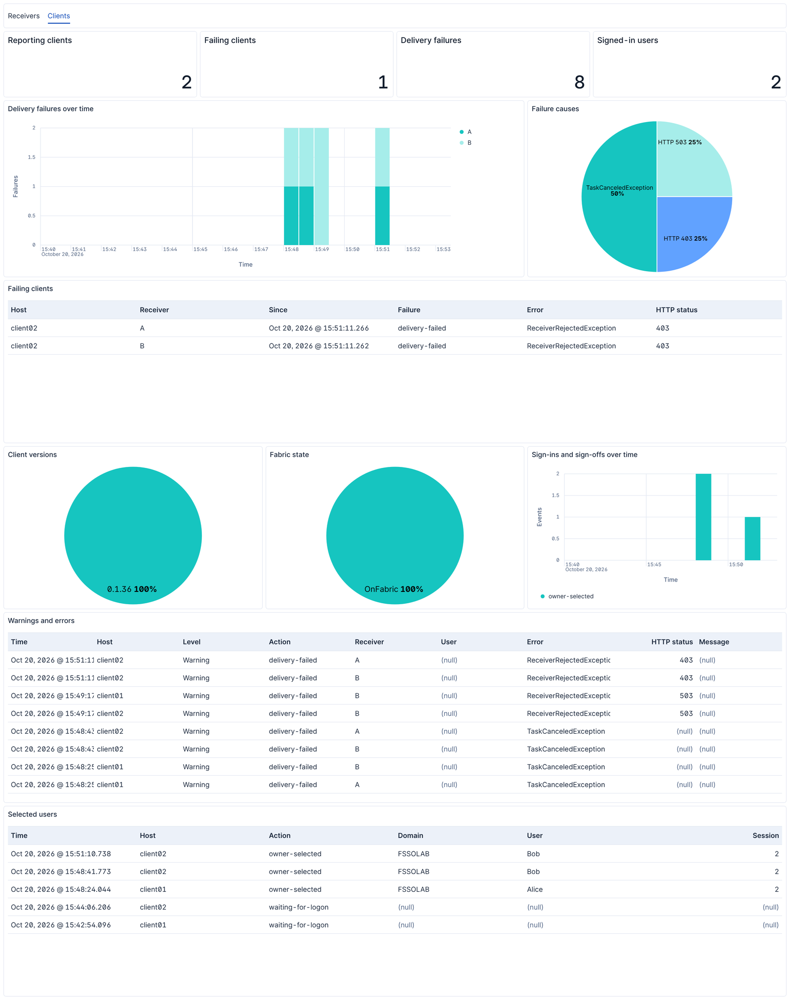

# OpenFSSO

FortiGate applies user-based firewall policies through Fortinet Single Sign-On
(FSSO), which needs to know which user is behind each IP address. The FSSO
Collector Agent normally infers this indirectly, from domain controller logon
events and by polling workstations.

OpenFSSO has each Windows workstation report its signed-in user directly:

- A client service on the workstation proves the user's identity with Kerberos
  to a receiver service on each Collector Agent host.
- The receiver takes the IP address from that connection, so a workstation can
  only report the address it actually uses.
- The receiver passes the mapping to the local Collector Agent over syslog: a
  login when the user signs in, a logout when they sign off, and an hourly update
  in between.

## Requirements

- Domain-joined 64-bit Windows 10 2004, Windows Server 2022 or newer.
- Fortinet Collector Agent 5.0.0291 or later in Advanced Mode on each receiver
  host.
- Direct paths from workstations to the receivers, without NAT or proxies, so
  every receiver sees the address FortiGate sees. Make the receiver port
  reachable from workstation networks only, since any domain account can map
  the address it connects from.
- The receivers and the AD, KDC, time and PKI services must be reachable
  without FSSO authorization.

## Installation

Download the client and server MSIs from
[the releases](https://github.com/zu3st/open-fsso/releases).
`gh attestation verify <file> --repo zu3st/open-fsso` confirms that a file was
built by this repository's release workflow.

Register each receiver's HTTP SPN on its computer account and bind a trusted certificate to its HTTP.sys listener:

```powershell
setspn -S HTTP/receiver-a.example.test EXAMPLE\COLLECTOR-A$
netsh http add sslcert ipport=0.0.0.0:8443 certhash=<thumbprint> appid={<guid>}
```

Adapt `config/client.example.yaml` and `config/receiver.example.yaml`. Give each
receiver its own random `HealthApiKey`, for example from
`python3 -c 'import secrets; print(secrets.token_urlsafe(32))'`. Keep certificate
revocation checking enabled.

Install from an elevated terminal or a SYSTEM deployment agent:

```powershell
msiexec /i OpenFSSO.Client-<version>.msi CONFIGFILE="C:\Release\client.yaml" /qn /norestart
msiexec /i OpenFSSO.Server-<version>.msi CONFIGFILE="C:\Release\server.yaml" /qn /norestart
```

The installer copies `CONFIGFILE` to `Config\config.yaml` below the application's
Program Files directory, readable only by Administrators and SYSTEM. Logs and
state are in `C:\ProgramData\OpenFsso\<service>\`. Upgrades, repairs and
uninstall keep the configuration unless `CONFIGFILE` supplies a new one. To
replace it in a same-version reinstall, add `REINSTALL=ALL REINSTALLMODE=vomus`.
A configuration that fails validation stops the service from starting, and the
installation rolls back. Return codes 0 and 3010 mean success.

The client MSI registers the tray for every sign-in and adds a Start menu entry.
The client service also starts the tray in sessions that are already signed in.

## Configuration

Both services use a YAML file, described by
[config/client.schema.json](config/client.schema.json) and
[config/receiver.schema.json](config/receiver.schema.json). A client lists one
to eight receivers under `Receivers`. Check a file before deployment with:

```powershell
OpenFsso.Client.exe --validate-config C:\Release\client.yaml
```

Changes take effect when the service restarts.

### Fabric detection

The optional client `onFabric` rule limits sending to the configured networks:

```yaml
onFabric:
  all:
    - clientIp: [10.12.0.0/16, 10.13.13.0/24]
    - any:
        - dhcpServer: {ip: 10.14.14.1, mac: '00:11:22:33:44:55'}
        - not:
            clientIp: [10.12.99.0/24]
```

Each node holds exactly one of `clientIp` (CIDR alternatives, IPv4 or IPv6),
`dhcpServer` (IPv4 address and optional MAC), `any`, `all` or `not`. `any` and
`all` take two or more rules, `not` takes one, and groups nest. The complete
rule is evaluated per active adapter and at least one adapter must pass. A MAC
matches only a DHCP server on the adapter's local link.

Detection runs before every request cycle. Off-fabric clients pause presence and
release, their receiver leases expire, and returning on-fabric sends fresh state.
The tray shows a blue dot while off-fabric.

## Fortinet collector

Enable the Collector Agent's syslog server on the receiver's `SyslogPort`
(UDP 514 by default). The receiver sends to it over loopback, so it runs on the
Collector Agent's host. The syslog server listens on all interfaces and accepts
any sender, so block inbound UDP 514 from the network with the host firewall.
The receiver sends lines such as:

```text
<134>OpenFsso action=login user="EXAMPLE\alice" group="ignored-by-remote-LDAP" ip=192.0.2.31 
```

Add this matching rule under **Advanced Settings > Syslog Source List**.
Replace `EXAMPLE` with the users' NetBIOS domain. Users of other domains do not
match and are not mapped. All three events are required.

| Field | Value |
| --- | --- |
| Trigger | `OpenFsso` |
| Logon | `action=login` |
| Logoff | `action=logout` |
| Update | `action=update` |
| Username | `user="EXAMPLE\{{:user}}"` |
| Client IPv4 | `ip={{:client_ip}} ` (with the trailing space) |
| Group | `group="{{:group}}"`, separator `,` |

Add a syslog source for the receiver's `SyslogSourceAddress` (default
`127.0.0.1`) with this rule and user type **Remote User / LDAP**, bound to an
LDAP server for the domain (user attribute `sAMAccountName`, groups from
`memberOf`). If another syslog source already uses `127.0.0.1`, set
`SyslogSourceAddress` to another loopback address, such as `127.0.0.2`. The
collector resolves the user's groups at every login and update. The group field
in the message is ignored.

Collector timers:

- **Workstation verify interval** `0`. The receiver reports logoffs and expired
  leases itself, so the collector's workstation checks are not needed.
- **Dead entry timeout** `480` minutes. It removes entries whose logout never
  arrived, while the receiver's hourly update (`ReassertSeconds: 3600`) keeps
  signed-in users from being removed.
- **IP address change verify interval** `0`, since the receiver reports address
  changes itself.

> [!WARNING]
> Other logon sources on the same collector, such as DC polling, can overwrite
> OpenFSSO's mappings with a different user for the same address. Turn them off
> for the networks OpenFSSO covers.

## Status and health


| Dot | Tooltip | Meaning |
| --- | --- | --- |
| Green | Connected | Every configured receiver acknowledged within the last two minutes |
| Amber | Connecting, Partially connected | First attempt running, or only some receivers healthy |
| Red | Delivery failed | All receivers failing |
| Red | Service unavailable, Network check unavailable | Client service or fabric check not answering |
| Gray | Waiting for logon or unlock | No selected user |
| Blue | Off fabric | Outside the configured networks, updates paused |

Scripts can read the status as JSON from `OpenFsso.Client.exe --status`, which
exits with 1 when the client service is not running:

```powershell
(OpenFsso.Client.exe --status | ConvertFrom-Json).View.Indicator -eq 'Connected'
```

Receivers serve `GET /health` with `Authorization: Bearer <HealthApiKey>`. It
reports whether the receiver is ready, how many users are mapped, whether the
collector service runs and whether syslog messages to it could be sent. It
answers 200 when all is well and 503 otherwise:

```bash
curl --header "Authorization: Bearer $HEALTH_API_KEY" https://receiver-a.example.test:8443/health
```

## Elastic integration

The integration in [elastic/openfsso](elastic/openfsso) collects the receiver
and client logs with Elastic Agent and adds dashboards for both. Each release
carries it as `openfsso-<version>.zip` for Kibana 9.5 or later. Upload it under
**Integrations > Create new integration > Upload it as a .zip**, or with the
Fleet API:

```bash
curl --header "kbn-xsrf: true" --header "Content-Type: application/zip" --user elastic --data-binary @openfsso-0.1.0.zip https://kibana.example.test:5601/api/fleet/epm/packages
```

Add it to two agent policies. The policy for the Collector Agent hosts keeps
only **OpenFSSO receiver logs** on, and the policy for the workstations keeps
only **OpenFSSO client logs** on.



## How it works in detail

- **Identity** comes only from the receiver's Kerberos authentication of the
  signed-in user, over TLS with strict channel binding. Each client keeps one
  session per receiver and authenticates it again about every hour.
- **Account status:** a Kerberos ticket stays valid after its account is
  disabled, so at each authentication the receiver asks the domain about the
  account with an S4U logon as its computer account. Disabled, locked-out,
  expired and deleted accounts are logged out and refused for an hour. Each
  check is a network logon (event 4624) on the receiver host.
- **IP address:** the client reports the local address of its connection, and
  the receiver accepts it only if it equals the connection's peer address.
- **Selected user:** the most recent console logon or unlock wins. Lock keeps the
  user, and RDP sessions count only with `AllowRdp`. After a service restart or
  installation, the saved user stays while their session is attached, and
  otherwise a single attached session is selected. Only several attached
  sessions without a matching record wait for the next logon or unlock.
- **Renewal:** the client renews every 60 seconds and backs off for 1–30 seconds
  after failures. Network, route and resume changes renew at once over a new
  connection.
- **Leases** live in receiver memory for 180 seconds after the last renewal. A
  restarted receiver starts empty and is repopulated within seconds, because
  clients reconnect immediately. After a collector restart, the receiver sends
  all its mappings again.
- **Logoff** sends a release, authorized by the lease reference from the last
  renewal, since the user's Kerberos credentials end with the session. Lease
  expiry covers lost releases.

## Building

Building needs only Docker:

```bash
docker build --target artifacts --output type=local,dest=artifacts .
python3 tools/build_msi.py --unsigned
```

The first command checks formatting, runs the tests and publishes the
executables to `artifacts/`. The second builds the client and server MSIs into
`artifacts/msi/`.

The Elastic integration builds with
[elastic-package](https://github.com/elastic/elastic-package), which writes
`build/packages/openfsso-<version>.zip`. Its dashboards are written as YAML in
`_dev/shared/kibana` and compiled to `kibana/dashboard` with Elastic's
[kb-dashboard](https://pypi.org/project/kb-dashboard-cli/) compiler.

```bash
elastic-package check -C elastic/openfsso
```

## Repository layout

- `src/OpenFsso.Client`: workstation service
- `src/OpenFsso.Tray`: notification icon
- `src/OpenFsso.Receiver`: receiver service for the Collector Agent host
- `src/OpenFsso.Core`, `src/OpenFsso.Windows`, `src/OpenFsso.Configuration`,
  `src/OpenFsso.Logging`: shared code. Logs are ECS JSON, with OpenFSSO fields
  under `openfsso.*`.
- `tests/`: application tests
- `config/`: example configurations and their JSON Schemas
- `deploy/msi/`: WiX installer sources
- `tools/`: formatting and packaging helpers
- `elastic/openfsso`: Elastic integration in the layout of Elastic's
  integrations repository
