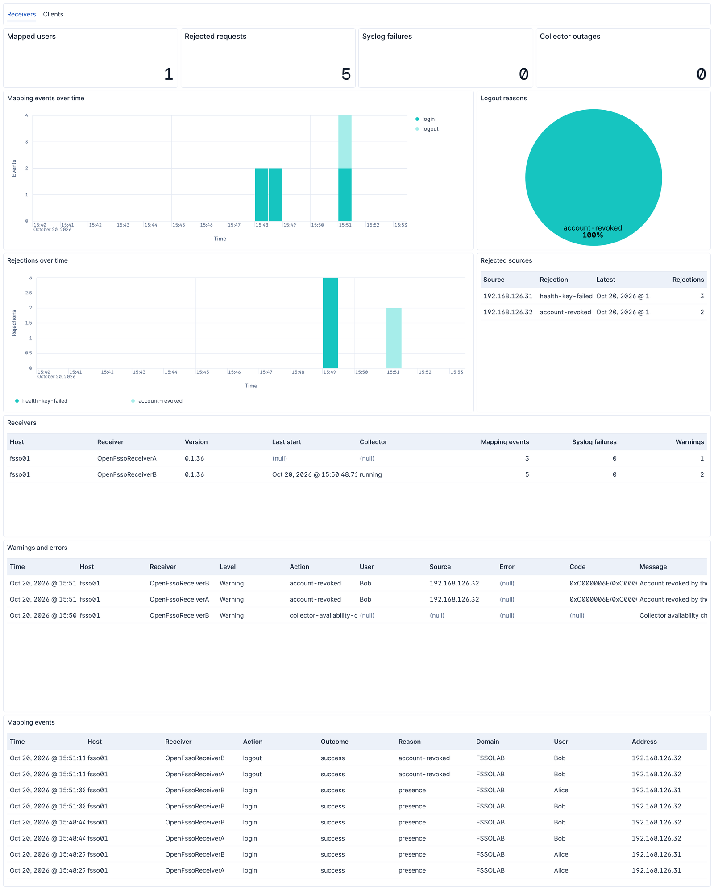

# OpenFSSO Integration

## Overview

[OpenFSSO](https://github.com/zu3st/open-fsso) maps Windows users to IP
addresses for FortiGate. A client service on each workstation proves the
signed-in user with Kerberos to receiver services on the Fortinet Collector
Agent hosts, which pass the mappings to the Collector Agent.

This integration collects the logs of both services, so you can follow which
users are mapped, spot workstations that fail to deliver, and see receivers
that reject requests or lose their collector.

### Compatibility

The integration reads the logs of OpenFSSO 0.1.36 or later. It needs Kibana
9.5.0 or later.

### How it works

Both services write one ECS JSON document per line to
`C:\ProgramData\OpenFsso\<service>\Logs\events-<date>.jsonl`. Elastic Agent
reads these files with the filestream input, and the ingest pipeline expands
the documents. Fields without an ECS equivalent are under `openfsso.*`.

## What data does this integration collect?

- `receiver`: mappings sent to the collector, rejected requests, accounts the
  domain revoked, collector availability and receiver starts.
- `client`: delivery failures and recoveries per receiver, the selected user,
  fabric detection, tray starts and client starts.

Every event has `event.action`, and most have `event.category`, `event.type`
and `event.outcome`. `service.node.name` is the Windows service name, which
tells several receivers on one host apart.

### Supported use cases

- Follow logins, updates and logouts per user and address.
- Find workstations whose deliveries fail, by receiver and HTTP status.
- Watch receivers for rejected identities, address claims and revoked accounts.
- Track the versions of the deployed clients and receivers.

## What do I need to use this integration?

Elastic Agent on the receiver hosts and on the workstations, enrolled in Fleet.

## How do I deploy this integration?

1. Add the integration to two agent policies, one for the Collector Agent
   hosts and one for the workstations.
2. In the receiver policy, turn on **OpenFSSO receiver logs** and turn off
   **OpenFSSO client logs**. In the workstation policy, do the reverse.
3. Adjust **Paths** when the services' `LogDirectory` differs from the default.

The default receiver path matches every service whose name starts with
`OpenFssoReceiver`.

### Dashboards

**[Logs OpenFSSO] Receivers** shows mapped users, rejected requests, syslog
failures, collector outages and the state of each receiver.



**[Logs OpenFSSO] Clients** shows which clients fail to deliver to which
receiver and why, their versions and fabric state, and the selected users.


### Validation

Open **[Logs OpenFSSO] Receivers** or **[Logs OpenFSSO] Clients** after a user
signs in to a workstation. A receiver logs a login within a minute.

## Troubleshooting

- Documents with `event.kind: pipeline_error` hold lines the pipeline could not
  parse, with the reason in `error.message`. Turn on **Preserve original event**
  to keep the raw line in `event.original`.
- The services keep their logs for 14 days. Agent skips files not modified
  within the **Ignore events older than** setting, 72 hours by default.

## Performance and scaling

A client writes a few events per sign-in and per network change. A receiver
writes a few events per signed-in user and hour, plus one per rejected request. Rejection warnings are limited to ten per minute.

## Reference

### receiver

An example event for `receiver` looks as following:

```json
{
    "@timestamp": "2026-10-20T06:00:00.123Z",
    "agent": {
        "ephemeral_id": "43f317ab-ffe6-44dc-acef-19fc1b9e5493",
        "id": "d9796606-59c3-4617-9dd2-24e291748df6",
        "name": "elastic-agent-10028",
        "type": "filebeat",
        "version": "9.5.5"
    },
    "data_stream": {
        "dataset": "openfsso.receiver",
        "namespace": "10441",
        "type": "logs"
    },
    "ecs": {
        "version": "9.0.0"
    },
    "elastic_agent": {
        "id": "d9796606-59c3-4617-9dd2-24e291748df6",
        "snapshot": false,
        "version": "9.5.5"
    },
    "event": {
        "action": "receiver-ready",
        "agent_id_status": "verified",
        "category": [
            "process"
        ],
        "dataset": "openfsso.receiver",
        "ingested": "2026-10-20T15:12:40Z",
        "kind": "event",
        "module": "openfsso",
        "original": "{\"@timestamp\":\"2026-10-20T08:00:00.1234567+02:00\",\"log.level\":\"Information\",\"message\":\"Receiver ready; Kerberos presence authentication and strict channel binding verified; Bearer health authentication enabled\",\"ecs.version\":\"9.0.0\",\"log\":{\"logger\":\"OpenFsso.Receiver\"},\"event\":{\"action\":\"receiver-ready\",\"category\":[\"process\"],\"kind\":\"event\",\"outcome\":\"success\",\"severity\":2,\"type\":[\"start\"]},\"service\":{\"name\":\"open-fsso-receiver\",\"node.name\":\"OpenFssoReceiverA\",\"version\":\"0.1.36\"},\"openfsso\":{\"runtime\":\"10.0.13\"}}",
        "outcome": "success",
        "severity": 2,
        "type": [
            "start"
        ]
    },
    "host": {
        "architecture": "x86_64",
        "containerized": false,
        "hostname": "elastic-agent-10028",
        "ip": [
            "172.18.0.2",
            "192.168.32.7"
        ],
        "mac": [
            "2A-4D-85-E6-6F-7D",
            "D6-87-29-B7-78-1C"
        ],
        "name": "elastic-agent-10028",
        "os": {
            "family": "",
            "kernel": "6.18.54.1-microsoft-standard-WSL2",
            "name": "Wolfi",
            "platform": "wolfi",
            "type": "linux",
            "version": "20230201"
        }
    },
    "input": {
        "type": "filestream"
    },
    "log": {
        "file": {
            "device_id": "2096",
            "fingerprint": "da10ac49bac44a0019ce97139f01a507a08d9753aae3bcf659a2b8153b7d9048",
            "inode": "3247505",
            "path": "/tmp/service_logs/receiver/events-20261020.jsonl"
        },
        "level": "Information",
        "logger": "OpenFsso.Receiver",
        "offset": 0
    },
    "message": "Receiver ready; Kerberos presence authentication and strict channel binding verified; Bearer health authentication enabled",
    "openfsso": {
        "runtime": "10.0.13"
    },
    "service": {
        "name": "open-fsso-receiver",
        "node": {
            "name": "OpenFssoReceiverA"
        },
        "version": "0.1.36"
    },
    "tags": [
        "preserve_original_event",
        "openfsso-receiver"
    ]
}
```

**Exported fields**

| Field | Description | Type |
|---|---|---|
| @timestamp | Event timestamp. | date |
| data_stream.dataset | Data stream dataset. | constant_keyword |
| data_stream.namespace | Data stream namespace. | constant_keyword |
| data_stream.type | Data stream type. | constant_keyword |
| error.code | Error code describing the error. | keyword |
| error.message | Error message. | match_only_text |
| error.type | The type of the error, for example the class name of the exception. | keyword |
| event.action | The action captured by the event. This describes the information in the event. It is more specific than `event.category`. Examples are `group-add`, `process-started`, `file-created`. The value is normally defined by the implementer. | keyword |
| event.category | This is one of four ECS Categorization Fields, and indicates the second level in the ECS category hierarchy. `event.category` represents the "big buckets" of ECS categories. For example, filtering on `event.category:process` yields all events relating to process activity. This field is closely related to `event.type`, which is used as a subcategory. This field is an array. This will allow proper categorization of some events that fall in multiple categories. | keyword |
| event.dataset | Event dataset. | constant_keyword |
| event.kind | This is one of four ECS Categorization Fields, and indicates the highest level in the ECS category hierarchy. `event.kind` gives high-level information about what type of information the event contains, without being specific to the contents of the event. For example, values of this field distinguish alert events from metric events. The value of this field can be used to inform how these kinds of events should be handled. They may warrant different retention, different access control, it may also help understand whether the data is coming in at a regular interval or not. | keyword |
| event.module | Event module. | constant_keyword |
| event.outcome | This is one of four ECS Categorization Fields, and indicates the lowest level in the ECS category hierarchy. `event.outcome` simply denotes whether the event represents a success or a failure from the perspective of the entity that produced the event. Note that when a single transaction is described in multiple events, each event may populate different values of `event.outcome`, according to their perspective. Also note that in the case of a compound event (a single event that contains multiple logical events), this field should be populated with the value that best captures the overall success or failure from the perspective of the event producer. Further note that not all events will have an associated outcome. For example, this field is generally not populated for metric events, events with `event.type:info`, or any events for which an outcome does not make logical sense. | keyword |
| event.reason | Reason why this event happened, according to the source. This describes the why of a particular action or outcome captured in the event. Where `event.action` captures the action from the event, `event.reason` describes why that action was taken. For example, a web proxy with an `event.action` which denied the request may also populate `event.reason` with the reason why (e.g. `blocked site`). | keyword |
| event.type | This is one of four ECS Categorization Fields, and indicates the third level in the ECS category hierarchy. `event.type` represents a categorization "sub-bucket" that, when used along with the `event.category` field values, enables filtering events down to a level appropriate for single visualization. This field is an array. This will allow proper categorization of some events that fall in multiple event types. | keyword |
| host.name | Name of the host. It can contain what hostname returns on Unix systems, the fully qualified domain name (FQDN), or a name specified by the user. The recommended value is the lowercase FQDN of the host. | keyword |
| http.response.status_code | HTTP response status code. | long |
| input.type | Type of the Filebeat input. | keyword |
| log.file.device_id | ID of the device containing the filesystem where the file resides. | keyword |
| log.file.fingerprint | The sha256 fingerprint identity of the file when fingerprinting is enabled. | keyword |
| log.file.idxhi | The high-order part of a unique identifier that is associated with a file. (Windows-only) | keyword |
| log.file.idxlo | The low-order part of a unique identifier that is associated with a file. (Windows-only) | keyword |
| log.file.inode | Inode number of the log file. | keyword |
| log.file.vol | The serial number of the volume that contains a file. (Windows-only) | keyword |
| log.level | Original log level of the log event. If the source of the event provides a log level or textual severity, this is the one that goes in `log.level`. If your source doesn't specify one, you may put your event transport's severity here (e.g. Syslog severity). Some examples are `warn`, `err`, `i`, `informational`. | keyword |
| log.offset | Offset of the entry in the log file. | long |
| message | For log events the message field contains the log message, optimized for viewing in a log viewer. For structured logs without an original message field, other fields can be concatenated to form a human-readable summary of the event. If multiple messages exist, they can be combined into one message. | match_only_text |
| openfsso.authentication_scheme | ASP.NET authentication scheme of an authentication event, `Windows` for presence sessions or `HealthKey` for the health endpoint. | keyword |
| openfsso.authentication_type | Authentication package of an identity the receiver rejected. | keyword |
| openfsso.claimed_ip | Address a client claimed for its connection when the receiver rejected the claim, or `invalid`. | keyword |
| openfsso.collector_available | Whether the Collector Agent service runs. | boolean |
| openfsso.collector_pid | Process ID of the Collector Agent service, 0 when it is stopped. | long |
| openfsso.failure_message | Reason an authentication scheme gave for a failed authentication. | keyword |
| openfsso.generation | Identifier of the client's selected logon, which renews or replaces a mapping. | keyword |
| openfsso.runtime | .NET runtime version of the service. | keyword |
| openfsso.suppressed | Number of rejection warnings dropped by the rate limit in the previous minute. | long |
| related.ip | All of the IPs seen on your event. | ip |
| related.user | All the user names or other user identifiers seen on the event. | keyword |
| service.name | Name of the service data is collected from. The name of the service is normally user given. This allows for distributed services that run on multiple hosts to correlate the related instances based on the name. In the case of Elasticsearch the `service.name` could contain the cluster name. For Beats the `service.name` is by default a copy of the `service.type` field if no name is specified. | keyword |
| service.node.name | Name of a service node. This allows for two nodes of the same service running on the same host to be differentiated. Therefore, `service.node.name` should typically be unique across nodes of a given service. In the case of Elasticsearch, the `service.node.name` could contain the unique node name within the Elasticsearch cluster. In cases where the service doesn't have the concept of a node name, the host name or container name can be used to distinguish running instances that make up this service. If those do not provide uniqueness (e.g. multiple instances of the service running on the same host) - the node name can be manually set. | keyword |
| service.version | Version of the service the data was collected from. This allows to look at a data set only for a specific version of a service. | keyword |
| source.ip | IP address of the source (IPv4 or IPv6). | ip |
| user.domain | Name of the directory the user is a member of. For example, an LDAP or Active Directory domain name. | keyword |
| user.id | Unique identifier of the user. | keyword |
| user.name | Short name or login of the user. | keyword |
| user.name.text | Multi-field of `user.name`. | match_only_text |


### client

An example event for `client` looks as following:

```json
{
    "@timestamp": "2026-10-20T06:00:00.123Z",
    "agent": {
        "ephemeral_id": "b9eefa09-f35d-4702-a86e-f406d832e68b",
        "id": "254677b7-dd2e-4dc6-9afd-9769f9cd2c8c",
        "name": "elastic-agent-10019",
        "type": "filebeat",
        "version": "9.5.5"
    },
    "data_stream": {
        "dataset": "openfsso.client",
        "namespace": "51786",
        "type": "logs"
    },
    "ecs": {
        "version": "9.0.0"
    },
    "elastic_agent": {
        "id": "254677b7-dd2e-4dc6-9afd-9769f9cd2c8c",
        "snapshot": false,
        "version": "9.5.5"
    },
    "event": {
        "action": "client-ready",
        "agent_id_status": "verified",
        "category": [
            "process"
        ],
        "dataset": "openfsso.client",
        "ingested": "2026-10-20T15:11:52Z",
        "kind": "event",
        "module": "openfsso",
        "original": "{\"@timestamp\":\"2026-10-20T08:00:00.1234567+02:00\",\"log.level\":\"Information\",\"message\":\"Client service ready\",\"ecs.version\":\"9.0.0\",\"log\":{\"logger\":\"OpenFsso.Client\"},\"event\":{\"action\":\"client-ready\",\"category\":[\"process\"],\"kind\":\"event\",\"outcome\":\"success\",\"severity\":2,\"type\":[\"start\"]},\"service\":{\"name\":\"open-fsso-client\",\"node.name\":\"OpenFssoClient\",\"version\":\"0.1.36\"},\"openfsso\":{\"runtime\":\"10.0.13\"}}",
        "outcome": "success",
        "severity": 2,
        "type": [
            "start"
        ]
    },
    "host": {
        "architecture": "x86_64",
        "containerized": false,
        "hostname": "elastic-agent-10019",
        "ip": [
            "172.18.0.2",
            "192.168.32.7"
        ],
        "mac": [
            "96-B2-86-DA-14-77",
            "E6-AD-89-9D-9C-D9"
        ],
        "name": "elastic-agent-10019",
        "os": {
            "family": "",
            "kernel": "6.18.54.1-microsoft-standard-WSL2",
            "name": "Wolfi",
            "platform": "wolfi",
            "type": "linux",
            "version": "20230201"
        }
    },
    "input": {
        "type": "filestream"
    },
    "log": {
        "file": {
            "device_id": "2096",
            "fingerprint": "404ab1667135138789f4d30ceb7948b367e151d082d2595492d321e245a9ddab",
            "inode": "3247476",
            "path": "/tmp/service_logs/client/events-20261020.jsonl"
        },
        "level": "Information",
        "logger": "OpenFsso.Client",
        "offset": 0
    },
    "message": "Client service ready",
    "openfsso": {
        "runtime": "10.0.13"
    },
    "service": {
        "name": "open-fsso-client",
        "node": {
            "name": "OpenFssoClient"
        },
        "version": "0.1.36"
    },
    "tags": [
        "preserve_original_event",
        "openfsso-client"
    ]
}
```

**Exported fields**

| Field | Description | Type |
|---|---|---|
| @timestamp | Event timestamp. | date |
| data_stream.dataset | Data stream dataset. | constant_keyword |
| data_stream.namespace | Data stream namespace. | constant_keyword |
| data_stream.type | Data stream type. | constant_keyword |
| error.code | Error code describing the error. | keyword |
| error.message | Error message. | match_only_text |
| error.type | The type of the error, for example the class name of the exception. | keyword |
| event.action | The action captured by the event. This describes the information in the event. It is more specific than `event.category`. Examples are `group-add`, `process-started`, `file-created`. The value is normally defined by the implementer. | keyword |
| event.category | This is one of four ECS Categorization Fields, and indicates the second level in the ECS category hierarchy. `event.category` represents the "big buckets" of ECS categories. For example, filtering on `event.category:process` yields all events relating to process activity. This field is closely related to `event.type`, which is used as a subcategory. This field is an array. This will allow proper categorization of some events that fall in multiple categories. | keyword |
| event.dataset | Event dataset. | constant_keyword |
| event.kind | This is one of four ECS Categorization Fields, and indicates the highest level in the ECS category hierarchy. `event.kind` gives high-level information about what type of information the event contains, without being specific to the contents of the event. For example, values of this field distinguish alert events from metric events. The value of this field can be used to inform how these kinds of events should be handled. They may warrant different retention, different access control, it may also help understand whether the data is coming in at a regular interval or not. | keyword |
| event.module | Event module. | constant_keyword |
| event.outcome | This is one of four ECS Categorization Fields, and indicates the lowest level in the ECS category hierarchy. `event.outcome` simply denotes whether the event represents a success or a failure from the perspective of the entity that produced the event. Note that when a single transaction is described in multiple events, each event may populate different values of `event.outcome`, according to their perspective. Also note that in the case of a compound event (a single event that contains multiple logical events), this field should be populated with the value that best captures the overall success or failure from the perspective of the event producer. Further note that not all events will have an associated outcome. For example, this field is generally not populated for metric events, events with `event.type:info`, or any events for which an outcome does not make logical sense. | keyword |
| event.reason | Reason why this event happened, according to the source. This describes the why of a particular action or outcome captured in the event. Where `event.action` captures the action from the event, `event.reason` describes why that action was taken. For example, a web proxy with an `event.action` which denied the request may also populate `event.reason` with the reason why (e.g. `blocked site`). | keyword |
| event.type | This is one of four ECS Categorization Fields, and indicates the third level in the ECS category hierarchy. `event.type` represents a categorization "sub-bucket" that, when used along with the `event.category` field values, enables filtering events down to a level appropriate for single visualization. This field is an array. This will allow proper categorization of some events that fall in multiple event types. | keyword |
| host.name | Name of the host. It can contain what hostname returns on Unix systems, the fully qualified domain name (FQDN), or a name specified by the user. The recommended value is the lowercase FQDN of the host. | keyword |
| http.response.status_code | HTTP response status code. | long |
| input.type | Type of the Filebeat input. | keyword |
| log.file.device_id | ID of the device containing the filesystem where the file resides. | keyword |
| log.file.fingerprint | The sha256 fingerprint identity of the file when fingerprinting is enabled. | keyword |
| log.file.idxhi | The high-order part of a unique identifier that is associated with a file. (Windows-only) | keyword |
| log.file.idxlo | The low-order part of a unique identifier that is associated with a file. (Windows-only) | keyword |
| log.file.inode | Inode number of the log file. | keyword |
| log.file.vol | The serial number of the volume that contains a file. (Windows-only) | keyword |
| log.level | Original log level of the log event. If the source of the event provides a log level or textual severity, this is the one that goes in `log.level`. If your source doesn't specify one, you may put your event transport's severity here (e.g. Syslog severity). Some examples are `warn`, `err`, `i`, `informational`. | keyword |
| log.offset | Offset of the entry in the log file. | long |
| message | For log events the message field contains the log message, optimized for viewing in a log viewer. For structured logs without an original message field, other fields can be concatenated to form a human-readable summary of the event. If multiple messages exist, they can be combined into one message. | match_only_text |
| openfsso.attached_sessions | Number of attached user sessions while the client waits for a logon or unlock. | long |
| openfsso.fabric_state | Fabric detection result, `Disabled`, `OnFabric`, `OffFabric` or `Unavailable`. | keyword |
| openfsso.generation | Identifier of the selected logon, sent with every renewal. | keyword |
| openfsso.receiver | Name of the receiver from the client configuration. | keyword |
| openfsso.runtime | .NET runtime version of the service. | keyword |
| openfsso.session_id | Windows session ID of the user session. | long |
| openfsso.tray_pid | Process ID of a started tray application. | long |
| related.ip | All of the IPs seen on your event. | ip |
| related.user | All the user names or other user identifiers seen on the event. | keyword |
| service.name | Name of the service data is collected from. The name of the service is normally user given. This allows for distributed services that run on multiple hosts to correlate the related instances based on the name. In the case of Elasticsearch the `service.name` could contain the cluster name. For Beats the `service.name` is by default a copy of the `service.type` field if no name is specified. | keyword |
| service.node.name | Name of a service node. This allows for two nodes of the same service running on the same host to be differentiated. Therefore, `service.node.name` should typically be unique across nodes of a given service. In the case of Elasticsearch, the `service.node.name` could contain the unique node name within the Elasticsearch cluster. In cases where the service doesn't have the concept of a node name, the host name or container name can be used to distinguish running instances that make up this service. If those do not provide uniqueness (e.g. multiple instances of the service running on the same host) - the node name can be manually set. | keyword |
| service.version | Version of the service the data was collected from. This allows to look at a data set only for a specific version of a service. | keyword |
| source.ip | IP address of the source (IPv4 or IPv6). | ip |
| user.domain | Name of the directory the user is a member of. For example, an LDAP or Active Directory domain name. | keyword |
| user.id | Unique identifier of the user. | keyword |
| user.name | Short name or login of the user. | keyword |
| user.name.text | Multi-field of `user.name`. | match_only_text |

